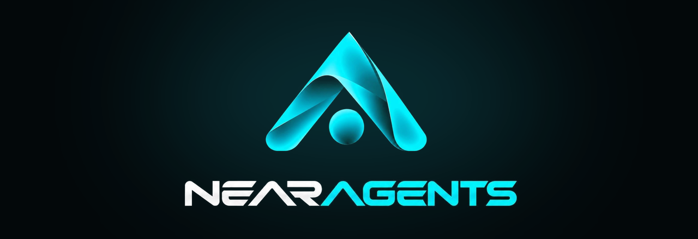

# NEARAGENTS

[](https://github.com/nearagents/nearagents/actions/workflows/verify.yml)

Token launchpad on NEAR. Every token launched here can run its own AI agent on X and Telegram.

Live at https://nearagents.fun

## Launching a token

One transaction, about 0.11 NEAR with gas. It creates the token, opens a Rhea DCL pool at the 0.01% tier and puts the whole supply in it.

- 1B supply, minted once
- the LP position is owned by a vault account with no keys and no code, so nobody can pull the liquidity (us included)
- no platform fee, on launch or on trades
- optional creator tax, up to 4% on buys and 4% on sells, set at launch and fixed after that. The creator splits it between buyback, burn, holders, themselves and the agent. If there is a tax, at least 20% of it goes to the agent.

Wallets: Meteor, OKX, Sender, Nightly, MyNearWallet.

## Agents

Set up from the studio after launch.

- X: posts from the token's own account (launch post, then regular posts based on NEAR news) and replies
- Telegram: community ambassador, answers holders, private chats
- buy bot: buy alerts with tiers, whale alerts, trending board with paid slots. Works for any NEAR token, not just ours.

The agent's budget comes from its share of the tax. New agents get a free first month.

## Mainnet contracts

| | account | code hash |
|---|---|---|
| factory | `launch.goodhare8003.near` | `7MBhvkD3odhS2e26eTsjgLLKaiTE1AogTbmQ38apKayH` |
| token (global contract) | | `AoPRQSq7cvnZtqBSruN8xi7LzYCb3CY3zVFu9dWtPNJP` |
| vault | `v0.launch.goodhare8003.near` | no code |
| guardian | `guardian.goodhare8003.near` | |

The factory and the vault have no access keys. The guardian can pause new launches and that's it: it can't touch tokens, trades or liquidity. We tested pause/resume on mainnet on Oct 16 ([pause](https://nearblocks.io/txns/DiSEGsgi7CEv83hYMQ9VZNf2V67SYBscGLSyjgZx3FbZ), [resume](https://nearblocks.io/txns/D3Jcy9ownLXWaWgQbXkRdWZWW69nafoAjmr17gH6KEQA)).

Full record in [deployments/mainnet.json](deployments/mainnet.json), methods and events in [docs/INTERFACE.md](docs/INTERFACE.md).

## Verify

```bash
node scripts/verify.mjs
```

Node 22, no dependencies. It reads mainnet over RPC and checks that:

- the factory code and the token global contract hash to the sha256 in `deployments/mainnet.json`
- the factory and every vault have no access keys, and the vaults have no code
- `get_config` matches the record (no platform account, 0 platform share, 0.01% pool, 4% max tax, guardian, keeper)
- the guardian pause/resume transactions went through

CI runs it on every push and once a day, see the badge at the top.

## Stack

Contracts in Rust (near-sdk 5). The token code is deployed once as a global contract, that's what keeps a launch at ~0.11 NEAR instead of several NEAR. Web app in React + TypeScript, backend in Node + Postgres.

Contract builds are reproducible: pinned toolchain, locked deps, wasm-opt. CI rebuilds them and fails if the bytes don't match the recorded hashes. Around 270 tests, including end-to-end runs on a local NEAR sandbox against Rhea's real mainnet code.

## Changelog

[CHANGELOG.md](CHANGELOG.md), taken from the main repo's commit log. Work started Sep 27, mainnet deploy on Oct 16.

## Source

The contracts and the app are closed source. This repo holds the deployment record and the tooling to check it.
